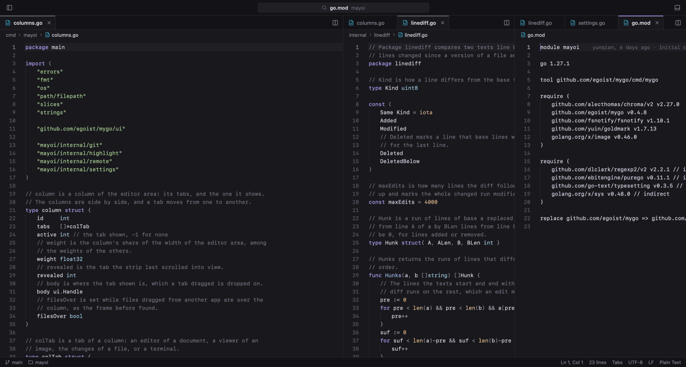
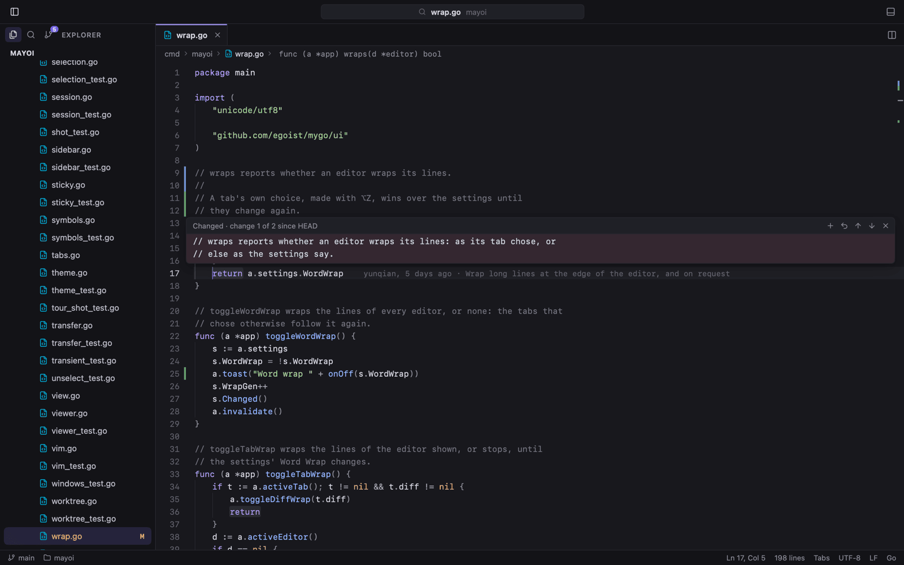
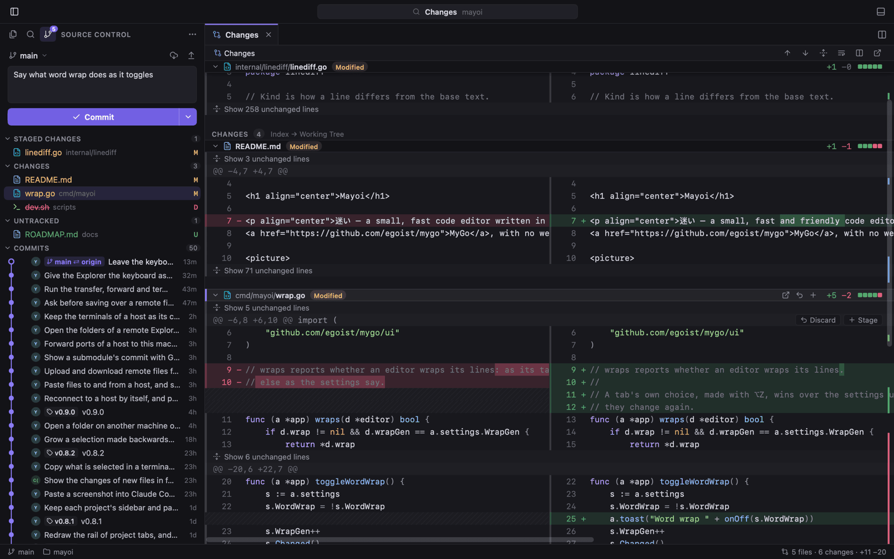
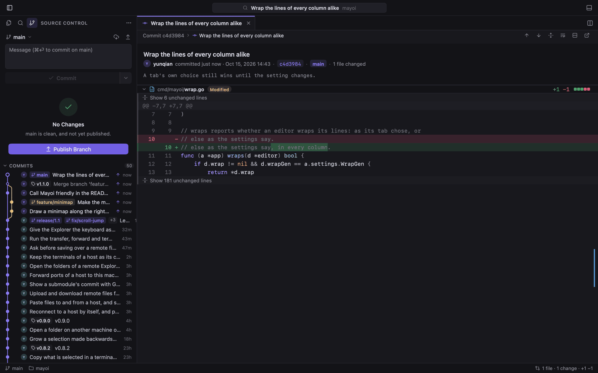
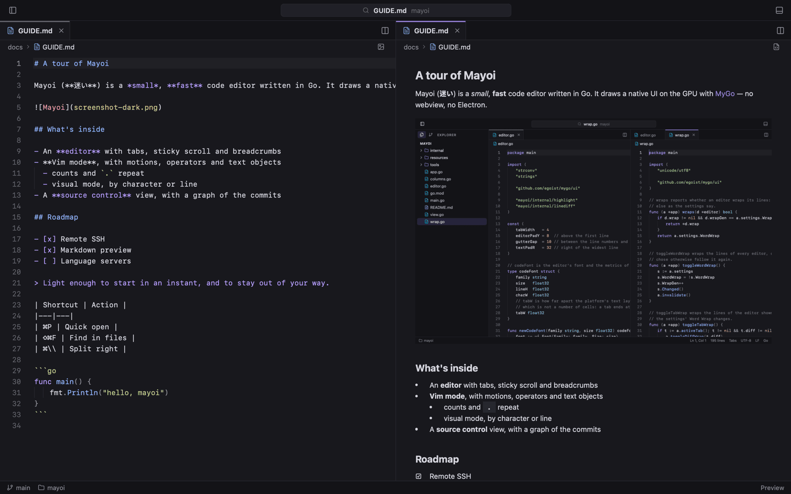
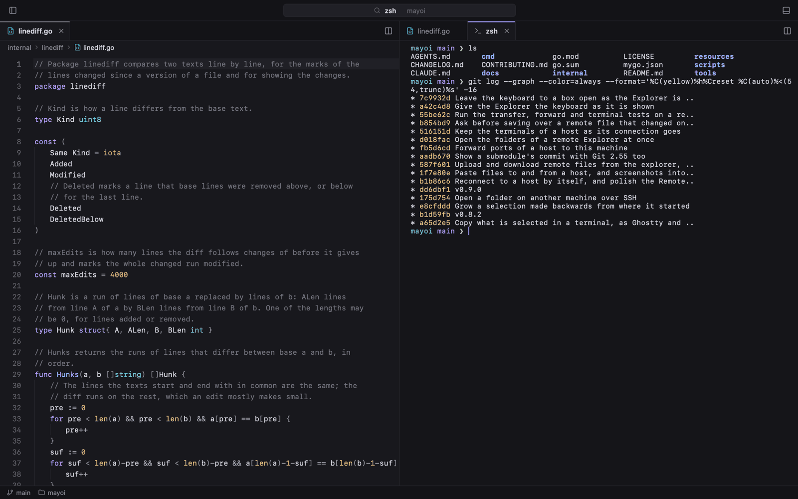
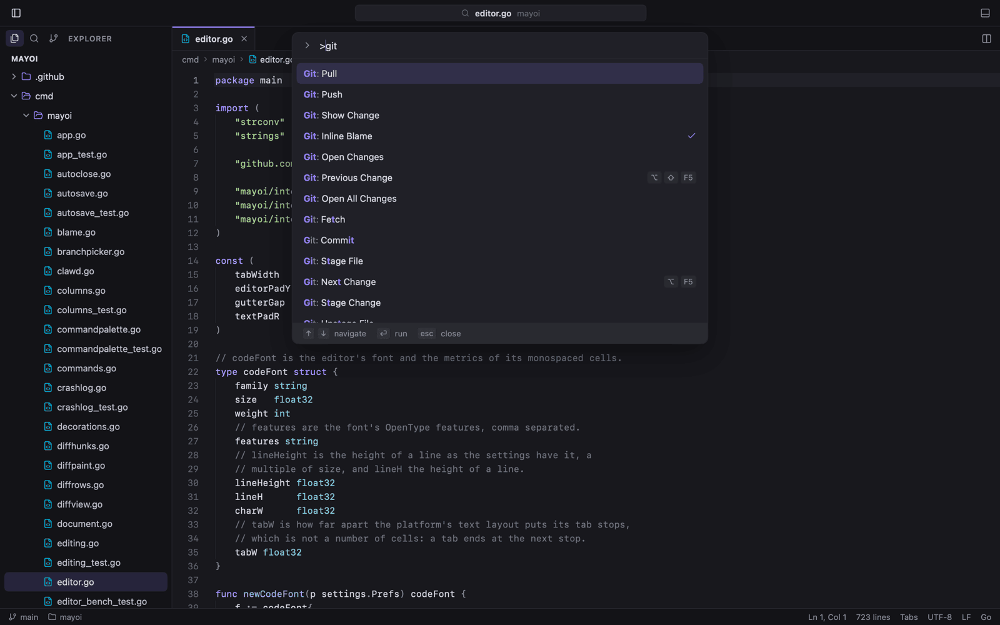
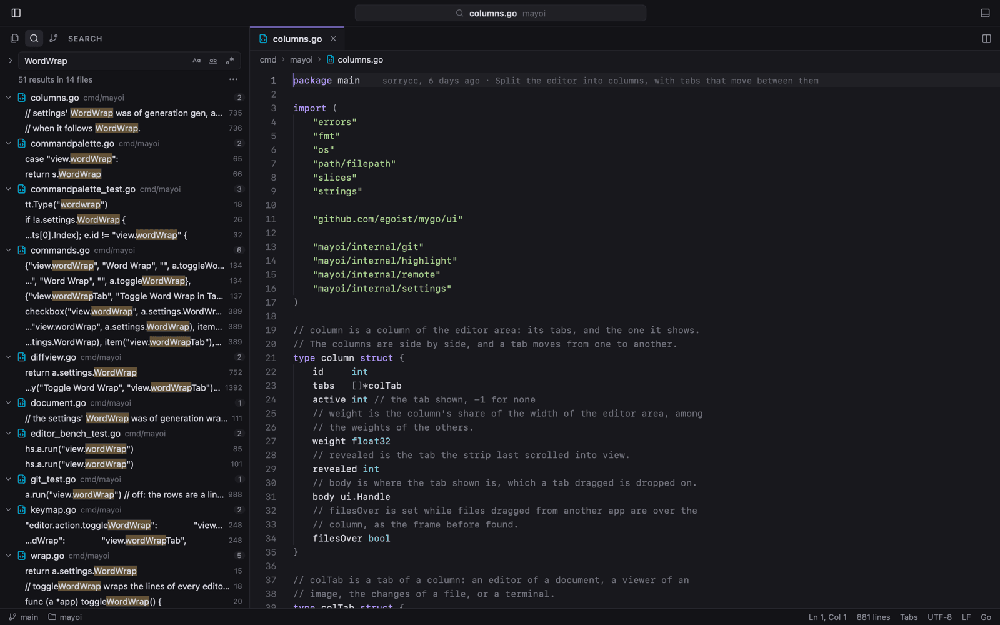
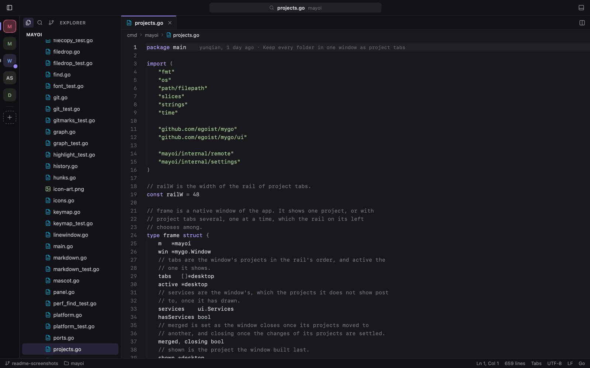
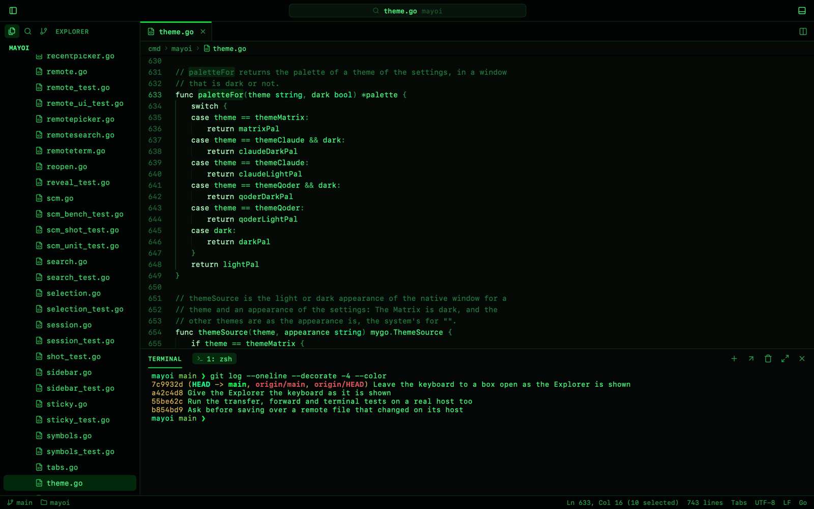

<p align="center">
  
</p>

<h1 align="center">MyCode</h1>

<p align="center">A small, fast code editor written in Zig. It draws a native UI on the GPU with
<a href="https://github.com/hunghg255/myzig">myzig</a>, with no webview and no Electron, and the installer is about 4 MB.</p>

<p align="center">By <a href="https://github.com/hunghg255">hunghg255</a>, from <a href="https://github.com/sorrycc/Mayoi">Mayoi</a> by chencheng.</p>

https://github.com/user-attachments/assets/673e7907-2b2c-4ed6-9093-1ba9633cd61c

## Features

- **Editor:** tabs with preview tabs, syntax highlighting for some seventy languages, a minimap, indent guides, sticky scroll, breadcrumbs,
  word wrap, and ⇧⌘T to reopen closed tabs
- **Smart editing:** auto-indent, auto-closing brackets and quotes, line commands, sorting, and per-tab undo
- **Columns:** split the editor side by side, drag tabs between columns, and lock a column for terminals
- **Explorer:** a live file tree that follows the disk, dims Git-ignored files, and shows Material or Lucide file icons
- **Quick open:** fuzzy file search, go to line (`:42`), go to symbol (`@`) and a command palette (`>`, ⇧⌘P)
- **Find and replace:** case, whole-word and regex matching, searched in the background in large files
- **Search:** find and replace across the folder's files (⇧⌘F, ⇧⌘H), with files to include and exclude, and a
  preview of each replacement
- **Git:** a source control view to stage, commit, amend, undo, pull, push, sync and force push, every change in one
  diff, folded around the changes, inline or side by side, with hunk staging, a graph of the commits with their
  branches and tags, gutter marks that revert or stage a change, inline blame, branches, stash and merge conflicts
- **Review comments:** comment on lines of a diff or a file, then send them all to the agent in the terminal
- **Terminal:** Ghostty's emulator (libghostty-vt), in the bottom panel or in a tab, with profiles (PowerShell, Git
  Bash, WSL and your own) and ⌘-click on `file:line:col` to open it in the editor
- **Image viewer:** PNG, JPEG, GIF, WebP and BMP
- **Previews:** a live preview of Markdown and SVG beside the source (⇧⌘V)
- **Windows:** project tabs that keep every folder in one window, a welcome page with the recent folders, Open Recent
  (⌃R), and a `mycode` shell command
- **Themes:** light and dark, The Matrix with digital rain, and Claude and Qoder, each in light and dark
- **Auto save,** and every window reopened as you left it, with its columns, tabs and carets
- **Settings:** JSON files applied as you save them, with the code's and the terminal's fonts, weight, ligatures and
  line height, and keyboard shortcuts in VS Code's format (see [docs/SETTINGS.md](docs/SETTINGS.md))

See [docs/FEATURES.md](docs/FEATURES.md) for the details, [docs/ARCHITECTURE.md](docs/ARCHITECTURE.md) for a tour of the
source and how fast it runs, and [CONTRIBUTING.md](CONTRIBUTING.md) to build, test and release MyCode.

## Documentation site

`docs/` is also a Vite + React site that presents every feature of MyCode, with the screenshots and shortcuts. It needs
Node.js 20.19 or later:

```sh
cd docs
npm install
npm run dev        # serve it at http://localhost:5173
npm run build      # build a static site into docs/dist
```

## Tour

<table>
  <tr>
    <td width="50%"><b>Columns</b>: split the editor and drag tabs between columns<br>
      <a href="docs/screenshots/columns.png"></a></td>
    <td width="50%"></td>
  </tr>
  <tr>
    <td><b>Peek a change</b>: click a gutter mark to see the lines at HEAD, then revert or stage them<br>
      <a href="docs/screenshots/change-peek.png"></a></td>
    <td><b>Side-by-side diff</b>: every change in one tab, with changed words tinted<br>
      <a href="docs/screenshots/scm-diff-split.png"></a></td>
  </tr>
  <tr>
    <td><b>Commit graph</b>: branches, tags and merges, and each commit's changes in a tab<br>
      <a href="docs/screenshots/commits.png"></a></td>
    <td><b>Markdown preview</b>: live beside the source<br>
      <a href="docs/screenshots/markdown-preview.png"></a></td>
  </tr>
  <tr>
    <td><b>Terminal</b>: Ghostty's emulator in the panel or, here, in a tab<br>
      <a href="docs/screenshots/terminal-tab.png"></a></td>
    <td><b>Command palette</b>: every command by name, with its shortcut<br>
      <a href="docs/screenshots/command-palette.png"></a></td>
  </tr>
  <tr>
    <td><b>Search in files</b>: as you type, with each match in context<br>
      <a href="docs/screenshots/search.png"></a></td>
    <td><b>Project tabs</b>: every folder in one window, on a rail<br>
      <a href="docs/screenshots/project-tabs.png"></a></td>
  </tr>
  <tr>
    <td></td>
    <td><b>The Matrix</b>: one of the themes, with the whole window in the code's font<br>
      <a href="docs/screenshots/theme-matrix.png"></a></td>
  </tr>
</table>

## Requirements

- Windows 10 or later to run it
- Zig 0.17 and a checkout of [myzig](https://github.com/hunghg255/myzig) beside this folder (`../myzig`), with its
  `terminal`, `watch` and `mainthread` plugins, to build it

MyCode is made and tested on Windows. Its code also compiles for Linux and macOS, which myzig draws on too, but
it hasn't been run there yet.

## Getting started

```sh
zig build run -- ~/some/project   # open a folder or a file
zig build                         # zig-out/bin/mycode.exe
zig build test                    # unit tests
zig build uitest                  # UI tests: the app run headless with scripts (uitest/main.zig)
zig build uitest -- search        # the UI tests whose names hold "search"
zig build -Doptimize=ReleaseSafe -Dwindows-gui=true   # zig-out/bin/mycode.exe, as the installer has it
zig-out/bin/mycode.exe <folder> --myzig-snapshot=shot.png --myzig-script="click:README.md"   # headless
```

The installed app adds `mycode` to your `PATH` and **Open with MyCode** to File Explorer's menu of folders and files
by itself, then run `mycode .` or `mycode <file>`. A second `mycode` hands its folders and files to the MyCode
already open.

Settings, keybindings and the windows' state are kept in `%APPDATA%\MyCode` (or the folder `MAYOI_DATA_DIR` names):
`settings.json`, `keybindings.json` and `state-zig.json`. MyCode's first start takes Mayoi's settings, when there
are some.

The UI tests make their folders in `%TEMP%\mycode-uitest`, each case with its own settings, and run the app with
`--myzig-snapshot` and a script: a step that finds no text fails, so `move:TEXT` checks a text is shown. Some cases
then check what the app wrote: a saved file, a commit, its state. Headless runs leave the `mycode` command and File
Explorer's menus alone.

The terminal downloads libghostty-vt and ConPTY into the user's cache the first time it opens, unless they are
beside the executable: `resources/` holds them for the installer (`ghostty-vt.dll`, `conpty.dll`,
`OpenConsole.exe`, from `%LOCALAPPDATA%\mygo\natives`; they are not in Git).

The file icons (the Material Icon Theme's) are in `icons/material`, made by `scripts/materialicons/update.sh`, and
embedded by `icons/material.zig`, which `python icons/update.py` writes. The UI's own icons (Lucide's) are in
`src/lucide.zig`.

## The installer

The myzig CLI (`cd ../myzig/cli && zig build -Doptimize=ReleaseSmall`) packages the app with its icon, version and
manifest (`myzig.zon`, and the version in `build.zig.zon`), and writes an NSIS script; with
[NSIS](https://nsis.sourceforge.io) installed it makes the installer:

```sh
../myzig/cli/zig-out/bin/myzig build --optimize safe
makensis .myzig/build/windows-x86_64/installer.nsi   # when the CLI didn't find makensis
```

`dist/windows-x86_64/` then holds `MyCode/`, a `.zip` and `MyCode Setup <version> x86_64.exe`, which installs for the
user into `%LOCALAPPDATA%\Programs\MyCode`, with a Start menu shortcut and an uninstaller. Uninstalling takes the
`mycode` command and the Explorer menu away, and offers to delete the settings.

A crash of a release started from Explorer writes what happened to `crash-zig.log` in the data folder; the last ten
move to `crashes/`.

## Not yet

- Updates download the whole installer and run it, without checking it against a signing key: myzig's updater
  plugin does, once releases carry its signed manifests (`myzig keygen`, `MYZIG_UPDATER_PRIVATE_KEY`).
- Review comments show on cards under the editor, not between its lines: myzig's text area leaves no room between
  lines yet. In a diff they are rows between its lines.

## Keyboard shortcuts

On Windows and Linux, ⌘ is Ctrl and ⌥ is Alt.

| Shortcut | Action |
|---|---|
| ⌘P / ⇧⌘O / ⌃G | Quick open / go to symbol / go to line |
| ⌘F / ⌥⌘F / ⌘G | Find / replace / next match |
| ⇧⌘F / ⇧⌘H | Find in files / replace in files |
| ⌘S / ⇧⌘S / ⌥⌘S | Save / save as / save all |
| ⌘O / ⌥⌘O / ⌃R | Open folder / open folder in a new window / open recent |
| ⌘N / ⌘W / ⌘1…9 / ⌃Tab | New file / close tab / go to tab / next tab |
| ⇧⌘T | Reopen closed tab |
| ⇧⌘] / ⇧⌘[ / ⌃⌘1…9 | Next / previous / go to project, with project tabs |
| ⌘\\ / ⌥⌘→ / ⌥⌘← | Split right / next column / previous column |
| ⌘B / ⌃\` / ⌃⇧\` | Toggle sidebar / toggle terminal panel / new terminal |
| ⌘Z / ⇧⌘Z | Undo / redo |
| Tab / ⇧Tab, ⌘] / ⌘[ | Indent / outdent |
| ⌘/ | Toggle line comment |
| ⌃⇧G / ⌥F5 / ⇧⌥F5 | Source control / next change / previous change |
| ⇧⌘M | Add review comment |
| ⌥↑ / ⌥↓, ⇧⌥↑ / ⇧⌥↓ | Move line / copy line |
| ⇧⌘K / ⌘↵ / ⇧⌘↵ | Delete line / insert line below / insert line above |
| ⌘L / ⇧⌘\\ | Select line / go to bracket |
| ⌘= / ⌘- / ⌘0 | Zoom text or image in / out / reset |
| ⇧⌘V | Toggle Markdown or SVG preview |
| ⌥Z | Toggle word wrap for the current tab |

## License

[MIT](LICENSE)
